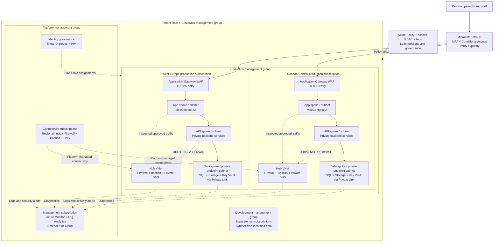

# Lab 10: Designing a Zero Trust Azure Landing Zone for CloudMed Solutions

**Company:** CloudMed Solutions Inc.  
**Application:** MedConnect  
**Deliverable:** Conceptual Azure landing zone design 

## 1. Company Overview

CloudMed Solutions Inc. is a healthcare technology company serving hospitals and clinics in Canada, the United States, and Europe. Its MedConnect platform supports online appointments and telehealth sessions, electronic medical records (EMRs), and AI-based health analytics. Doctors, patients, and staff need reliable access to the platform, but patient information must remain private.

I chose a **Zero Trust** approach because healthcare data is sensitive and a user or device should not be trusted just because it is already connected to the company's network. Every important request should be checked, permissions should be limited, and an attacker who gets into one part of the environment should not automatically reach the rest.

CloudMed needs to consider **HIPAA** for applicable US health information, **GDPR** for personal data handled in the European context, and **PIPEDA** and other applicable Canadian privacy laws. It also needs reliable service across regions, clear accountability for resources, central monitoring, and manageable costs. This design uses **Canada Central** and **West Europe** as its two Azure regions. CloudMed would review where each customer's data may be stored and transferred before deciding which region serves that customer. Two selected regions do not, on their own, satisfy every residency or cross-border transfer requirement.

## 2. Governance and Identity

### Management group hierarchy

I would organize the Azure environment so common platform services are managed separately from production and development workloads:

```text
Tenant Root Management Group
└── CloudMed
    ├── Platform
    │   ├── Connectivity   → regional hubs, firewalls, DNS, Bastion
    │   ├── Management     → monitoring and security operations
    │   └── Identity       → identity-related shared services, if needed
    ├── Production         → MedConnect production subscriptions
    │   ├── Canada Central production subscription
    │   └── West Europe production subscription
    └── Development        → isolated non-production subscription(s)
```    

Management groups provide a place to inherit governance rules; **subscriptions**, not management groups, hold the deployed resources. Platform administrators manage shared connectivity and monitoring while application teams work within their own subscriptions. Development cannot access real patient records by default, and test environments should use synthetic or de-identified data.

### Role-based access control (RBAC)

| Team | Proposed access | Reason |
|---|---|---|
| Cloud platform administrators | Privileged roles only when required, scoped to platform subscriptions | Manage shared infrastructure without permanent broad access |
| DevOps developers | Contributor-level access to their specific application resource groups, without permission to grant roles | Deploy and maintain MedConnect without controlling the entire tenant |
| Security operations | Security Reader / monitoring roles, with separately approved incident-response permissions | Investigate incidents and review alerts |
| Finance | Cost Management Reader or equivalent billing-scoped viewing access | Track costs without changing application resources |

I would use **Microsoft Entra ID** groups for role assignments rather than assigning rights separately to each employee. Privileged Identity Management (PIM), where licensed and configured, would provide time-limited, approval-based administrator activation. Break-glass accounts would be tightly controlled and monitored.

### Identity protection

- Require multifactor authentication (MFA) for staff, especially administrators.
- Use **Conditional Access** to consider sign-in risk, location, device compliance, and the application being accessed; block or challenge risky attempts.
- Use **managed identities** for supported Azure services so applications do not store passwords in their source code.
- Review permissions regularly and remove access when a person's role changes.

### Azure Policy and consistency

CloudMed would assign Azure Policies at the appropriate management group or subscription scope to:

- Allow workload resources only in **Canada Central** and **West Europe**, with documented exceptions for global or unsupported services.
- Require tags such as `Environment`, `Owner`, `CostCenter`, `DataClassification`, and `Region`.
- Restrict or audit public IPs and public access to sensitive data services.
- Require diagnostic settings, encryption where supported, and approved resource configurations.
- Report noncompliant resources and use `deny`, `audit`, or `deployIfNotExists` effects as appropriate after testing policies.

Policies provide preventive and detective guardrails, but CloudMed must still review exemptions and correct noncompliance.

## 3. Network Architecture

### Hub-and-spoke design

I propose **one regional hub-and-spoke environment in Canada Central and another in West Europe**. This avoids making all European traffic depend on a Canadian hub and gives each region its own security boundary. Both regions follow the same security baseline, while their workloads and data can remain separate.

The **hub VNet** in each region includes:

- **Azure Firewall:** centrally filters allowed inbound/outbound and spoke-to-spoke traffic.
- **Azure Bastion:** secure administrative RDP/SSH access to supported private VMs without giving those VMs public IP addresses.
- **Azure DNS Private Resolver / private DNS integration:** helps services resolve private endpoint names.
- **VNet peering and route tables:** connect approved spokes and steer inspection traffic through the firewall.

**Log Analytics** is a centrally managed Azure Monitor workspace in the **Management subscription**, not a resource that has to live inside the hub VNet. Both hubs and all spokes send relevant diagnostic and security telemetry to the monitoring layer.

### Isolated workload spokes

| Spoke / subnet | Main workload | Access rule |
|---|---|---|
| App spoke / App subnet | MedConnect web and mobile backends | HTTPS through a protected public entry point, such as Application Gateway WAF; no direct public access to internal services |
| API spoke / API subnet | Backend services and authorization logic | Only approved traffic from the App tier; use managed identity and application-level authorization |
| Data spoke / private endpoint subnet | Private endpoints for Azure SQL, Storage, and Key Vault | Only the API and explicitly approved management services can reach private data endpoints |

For internet-facing access, users connect over **HTTPS** to **Application Gateway with Web Application Firewall (WAF)**. The gateway forwards approved requests to the App tier, which calls the API tier. The API connects to Azure SQL and Storage using private endpoints. The actual SQL and Storage resources are managed Azure services, not virtual machines hosted inside the VNet.

**East–west traffic** means communication between workloads inside Azure, such as App → API or API → Data. I would use network security groups (NSGs), firewall rules, and user-defined routes (UDRs) to allow only necessary flows. Spokes are not automatically trusted simply because they are peered with the hub. For inspected spoke-to-spoke traffic, routing must explicitly send traffic through Azure Firewall rather than letting VNet peering bypass inspection. Within a spoke, NSGs and workload-level controls limit access further.

Public network access to Azure SQL, Storage, and Key Vault would be disabled where supported. Private DNS zones must be linked and configured correctly so application names resolve to private endpoint addresses. Encryption in transit (TLS) and at rest would protect stored and transmitted patient records, with keys and secrets managed through Azure Key Vault and documented rotation practices.

For availability, CloudMed can deploy the same application architecture in both regions. Any cross-region replication or failover involving patient data must first be approved against the relevant residency and privacy requirements. The two regions are **not** assumed to freely replicate all records between them.

## 4. Zero Trust Controls

The design follows the three main Zero Trust principles:

### Verify explicitly

Every access request should be checked based on the identity, requested resource, and available risk information. Staff use Entra ID, MFA, and Conditional Access; MedConnect APIs also validate application tokens and user permissions. A successful network connection by itself does not authorize access to a patient's record.

### Use least privilege access

Admins activate privileged roles only when needed; DevOps access is limited to their application resources; finance has read-only cost visibility; and application services receive only the data permissions required for their job. Managed identities reduce long-lived credentials.

### Assume breach

If one workload is compromised, the attacker should still face barriers before reaching other workloads. App, API, and private data access are separated; NSGs and Azure Firewall restrict traffic; encryption reduces data exposure; and logs and alerts support detection and response. Incident procedures would include isolating affected resources, revoking credentials, investigating logs, notifying appropriate teams, and restoring from tested backups.

### Five concrete design examples

| Control | How it supports Zero Trust |
|---|---|
| 1. Entra ID + MFA + Conditional Access | Verifies staff access using identity and risk signals |
| 2. PIM + scoped Azure RBAC | Avoids standing administrator access and limits permissions |
| 3. Azure Bastion | Gives administrators a controlled private management path without public VM IPs |
| 4. Private Link for Azure SQL/Storage/Key Vault | Keeps sensitive service access on private endpoints instead of exposing public data interfaces |
| 5. Azure Policy + NSGs + Azure Firewall | Enforces network guardrails, segments tiers, and blocks unnecessary communication |

## 5. Monitoring, Compliance, and Cost

### Monitoring and incident response

CloudMed would collect Azure activity logs, firewall and WAF logs, application performance information, and service diagnostics with **Azure Monitor** and **Log Analytics**. **Microsoft Defender for Cloud** would highlight security recommendations, relevant alerts, and regulatory control mappings. Critical alerts, such as suspicious privileged sign-ins, unexpected public exposure, or unusual data access patterns, would go to the security operations team with clear ownership and response procedures. Logs containing patient information should be minimized, access-controlled, and retained according to approved requirements.

### Compliance and data protection

Azure Policy initiatives can help assess resource configurations against mapped controls, including relevant HIPAA/HITRUST guidance where applicable. CloudMed would document evidence for encryption, access reviews, vulnerability management, backup and recovery testing, privacy impact assessments, retention, deletion, and incident response. GDPR and PIPEDA obligations also depend on the actual personal data processing and applicable law.

**Important:** A green Azure Policy compliance dashboard does not prove legal compliance with HIPAA, GDPR, or PIPEDA. CloudMed and Microsoft have different responsibilities under the cloud shared-responsibility model. CloudMed must involve privacy and legal specialists to review contracts, healthcare data handling, patient rights, and regional data transfers.

### Cost management

I would use **Azure Cost Management** budgets and alerts at subscription level, with monthly reviews of spending trends. The resource tags `Environment`, `Owner`, `CostCenter`, and `Application` help explain who owns costs. Development resources could be scheduled to shut down when not needed, where appropriate, and teams would periodically right-size compute and storage. Budgets provide alerts, but do not automatically stop every Azure charge.

## 6. Conceptual Zero Trust Landing Zone Diagram

The following **Mermaid diagram renders directly in GitHub Markdown**. It is conceptual, not a detailed Azure deployment topology.



**Reading the diagram:**

1. **Verify explicitly:** Entra ID, MFA, Conditional Access, and application authorization check users and services.
2. **Least privilege:** Management groups, scoped RBAC, PIM, and Azure Policy limit who can change resources.
3. **Assume breach:** Separate regional hubs, isolated App/API/Data spokes, Firewall, WAF, NSGs, private endpoints, and monitoring reduce opportunities for an attacker to move across the environment.

> **Diagram simplification:** The management group boxes show organizational governance, not literal network containers. Services such as Azure SQL and Storage remain managed PaaS resources reached through private endpoints. The App → API → Data arrows show permitted application flows, which are also subject to routing and security controls. Entra ID governs staff identities; MedConnect must separately implement suitable patient authentication and authorization. The region-to-region data connection is deliberately omitted because no unrestricted cross-border data transfer is approved in this design.

## 7. Summary and Recommendations

I designed CloudMed's landing zone to give MedConnect a secure and organized foundation rather than treating security as something added at the end. Separating the application, backend, and data layers limits access to patient records. Central governance keeps rules consistent, while regional hubs let Canada Central and West Europe operate with their own network protections. Monitoring and cost management help CloudMed run the platform responsibly as it grows.

**My two recommendations for future improvement are:**

1. **Automate the landing zone with Infrastructure as Code (IaC).** Use Bicep or Terraform together with policy-as-code and deployment reviews. This would make the Canada and Europe environments easier to reproduce consistently and reduce manual configuration mistakes.
2. **Improve resilience through tested recovery plans and ongoing cost reviews.** Define recovery objectives, practise restoring backups and failing over approved workloads, and review unused resources and storage costs each month. Any regional data replication must follow CloudMed's privacy and residency decisions.

Overall, the proposed architecture supports **security** through verification and isolation, **compliance readiness** through governance and evidence gathering, and **scalability** through repeatable regional landing zones. It is a starting design that would need implementation, testing, and compliance review before it could host real patient data.

## References

The design was informed by the following Microsoft Learn resources:

1. [What is an Azure landing zone?](https://learn.microsoft.com/en-us/azure/cloud-adoption-framework/ready/landing-zone/)
2. [Azure landing zone management groups](https://learn.microsoft.com/en-us/azure/cloud-adoption-framework/ready/landing-zone/design-area/resource-org-management-groups)
3. [Incorporate Zero Trust practices in your landing zone](https://learn.microsoft.com/en-us/azure/cloud-adoption-framework/ready/landing-zone/design-area/security-zero-trust)
4. [Landing zone identity and access management](https://learn.microsoft.com/en-us/azure/cloud-adoption-framework/ready/landing-zone/design-area/identity-access-landing-zones)
5. [Hub-and-spoke network topology](https://learn.microsoft.com/en-us/azure/architecture/reference-architectures/hybrid-networking/hub-spoke)
6. [Azure Private Link in a hub-and-spoke network](https://learn.microsoft.com/en-us/azure/architecture/networking/guide/private-link-hub-spoke-network)
7. [Regulatory compliance in Azure Policy](https://learn.microsoft.com/en-us/azure/governance/policy/concepts/regulatory-compliance)
8. [Azure compliance for Canadian privacy laws](https://learn.microsoft.com/en-us/azure/compliance/offerings/offering-canada-privacy-laws)
9. [Azure compliance for HIPAA](https://learn.microsoft.com/en-us/azure/compliance/offerings/offering-hipaa-us)
10. [Multi-region network design](https://learn.microsoft.com/en-us/azure/networking/design-guide/multi-region)
